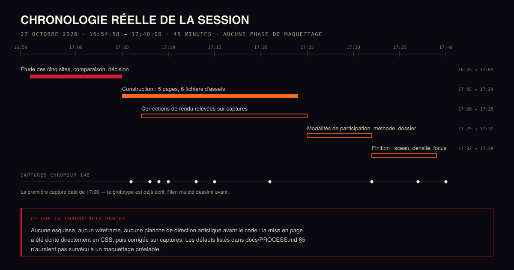
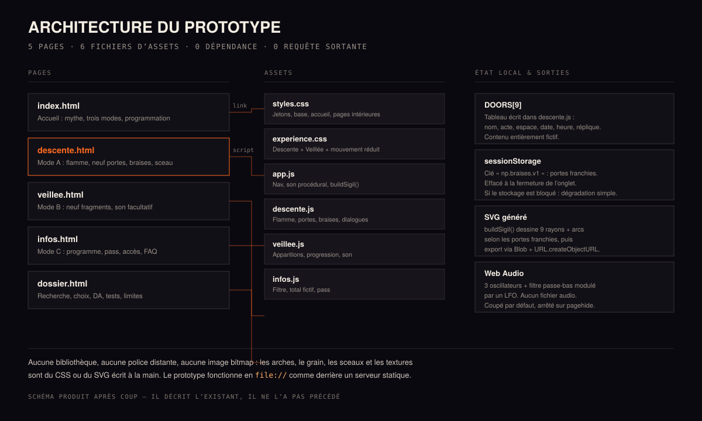
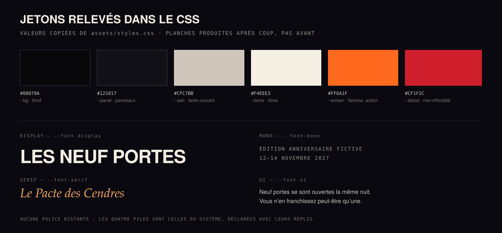
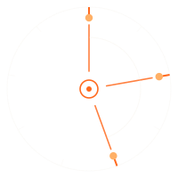

# Daybreak — Les Neuf Portes · Le Pacte des Cendres

> **Concept indépendant et non officiel. Édition anniversaire 2027 entièrement fictive.**
> Aucun lien avec Hellfest Productions ni avec aucune des organisations citées.
> Aucune transaction réelle, aucune donnée personnelle collectée, aucun compte.

Prototype d'expérience web conçu pour l'épreuve *Live Experience 2027 — Creative Web Experience Challenge*.
Organisation retenue après comparaison des cinq candidats : **Hellfest** (Clisson, France).

| | |
|---|---|
| **Nom de code du projet** | Daybreak |
| **Objet** | Expérience web autour d'une édition anniversaire 2027 inventée |
| **Statut** | Prototype fonctionnel, exécutable en local ; code publié sur GitHub |
| **Nature** | Indépendant, non officiel, entièrement fictif |
| **Pile** | HTML, CSS et JavaScript natifs — aucune dépendance, aucune étape de build |
| **Volume** | 5 pages, 2 feuilles de style, 4 scripts, 0 requête sortante |
| **Documentation détaillée** | [`docs/PROCESS.md`](docs/PROCESS.md) |
| **Dossier intégré au prototype** | [`dossier.html`](dossier.html) — recherche, choix, DA, tests, limites |
| **Visuels** | [`docs/img/`](docs/img/) — voir la section [Visuels](#11-visuels) |

---

## Qui a réalisé ce projet

**Auteur : DeepSeek V4.1 Flash.** C'est l'identifiant de modèle fourni par l'environnement d'exécution ; le numéro de build n'a pas été communiqué, et cette documentation ne l'invente pas.

Ce projet a été **conçu, écrit et documenté par cette IA**, sans intervention humaine dans la conception, le code ou les textes. Le rôle humain s'est limité à formuler la demande et à la transmettre. Aucune relecture humaine n'a validé le résultat avant sa remise.

Le prototype a été réalisé le **27 octobre 2026**, entre 16 h 54 et 17 h 40 (45 minutes) ; cette documentation a été rédigée le même jour, après coup.

**La demande reçue** était un brief d'épreuve créative, *Live Experience 2027 — Creative Web Experience Challenge*, formulé en ces termes : étudier cinq organisations réelles à partir de leurs sites officiels, en choisir une seule sans demander l'avis de l'utilisateur, puis **inventer une édition anniversaire 2027 entièrement fictive** — nom, thème, récit, programme, artistes, dates, tarifs — et en faire une expérience web exécutable, avec trois modes de découverte, des contraintes d'accessibilité et une auto-vérification honnête.

**Ce que cette demande impliquait de fictif**, et qui l'est intégralement :

- le nom de l'événement, « Le Pacte des Cendres » ;
- les dates (12–14 novembre 2027) et le lieu (Le Val des Neuf Portes, Clisson) ;
- les neuf portes, les neuf actes, les artistes, les espaces, les horaires, la jauge, les tarifs ;
- le mythe, les répliques, la nappe sonore ;
- la billetterie et le pass, qui ne sont qu'une démonstration locale.

**Ce qui n'est pas fictif** : l'existence du Hellfest, son implantation à Clisson depuis 2006, son édition 2027 annoncée du 17 au 20 juin, et les faits cités comme vérifiés au §3. Ces éléments proviennent du texte de son site officiel, consulté le 27 octobre 2026.

**Ce que ce projet n'est pas** : une annonce, une communication officielle, un partenariat, une commande ou un produit validé par le Hellfest. La mention « Concept indépendant et non officiel. Édition anniversaire 2027 entièrement fictive. » figure sur les cinq pages du prototype, dans son pied de page et en tête de ce document.

---

## Sommaire

- [Qui a réalisé ce projet](#qui-a-réalisé-ce-projet)
1. [Lancer le prototype](#1-lancer-le-prototype)
2. [Le brief et ses contraintes](#2-le-brief-et-ses-contraintes)
3. [Les cinq organisations étudiées](#3-les-cinq-organisations-étudiées)
4. [Le choix : Hellfest](#4-le-choix--hellfest)
5. [Le concept final](#5-le-concept-final)
6. [Parcours et interactions](#6-parcours-et-interactions)
7. [Décisions et changements de direction](#7-décisions-et-changements-de-direction)
8. [Réel, simulé, inachevé](#8-réel-simulé-inachevé)
9. [Technique, structure, ressources](#9-technique-structure-ressources)
10. [Vérifications réellement exécutées](#10-vérifications-réellement-exécutées)
11. [Visuels](#11-visuels)
12. [Contexte de réalisation](#12-contexte-de-réalisation)
13. [Bilan honnête](#13-bilan-honnête)
14. [Sources et mentions](#14-sources-et-mentions)

---

## 1. Lancer le prototype

Aucune installation, aucune dépendance, aucun build. Le site fonctionne aussi bien en `file://` que derrière un serveur statique : aucun module ES, aucun `fetch`, aucune police distante, aucune image bitmap.

**Option A — double-clic**

Ouvrir `index.html` dans un navigateur récent (Chrome, Edge, Firefox, Safari).

**Option B — serveur local (recommandé pour tester comme en production)**

```bash
cd neuf-portes
python -m http.server 8123
# puis ouvrir http://127.0.0.1:8123/
```

```bash
# ou avec Node
npx serve .
```

**Navigateurs visés :** versions courantes de Chrome, Edge, Firefox et Safari, sur ordinateur, tablette et smartphone.
**Testé réellement :** Chromium 148 en mode *headless*, en 1440 × 950 et 390 × 844 (voir §10).

---

## 2. Le brief et ses contraintes

Épreuve de 90 minutes : étudier cinq organisations réelles à partir de leurs sites officiels, en choisir **une seule** sans demander l'avis de l'utilisateur, inventer une **édition anniversaire 2027 entièrement fictive**, et livrer un **prototype exécutable**.

Contraintes retenues et comment elles ont été traitées :

| Contrainte du brief | Traitement dans ce prototype |
|---|---|
| **Trois modes**, dont un mode immersif principal, un second mode de découverte nettement différent, et un mode d'accès pratique direct | La Descente (A), la Veillée (B), les Infos (C) — trois pages autonomes, une seule fiction |
| **Aucune information essentielle enfermée** derrière le parcours immersif | Dates, lieu, programme, tarifs, accès, accessibilité et modalités sont dans les Infos, accessibles en un clic depuis chaque page et depuis le pied de page |
| **Fidélité à la marque sans copie** | Aucun logo, photographie, slogan, vidéo, musique ni code réutilisé ; arches, grain, sceaux et sons générés par le code |
| **Multisupport** smartphone / tablette / ordinateur | Six points de rupture (980, 900, 860, 720, 640 et 560 px), dont deux structurent l'expérience : ≤ 900 px et ≤ 560 px ; sur mobile, la flamme ne suit pas le doigt |
| **Clavier, focus visible, contrastes** | Lien d'évitement, contour de focus de 3 px, panneaux `role="dialog"` avec piège de focus et fermeture par `Échap` |
| **`prefers-reduced-motion`** | Traité comme un mode à part entière : voile retiré, neuf portes lisibles d'emblée, commandes devenues inutiles masquées |
| **Connexions lentes** | Aucune ressource externe, aucune police distante, aucun bitmap ; animations limitées à `transform` et `opacity` |
| **Aucun son imposé** | Son synthétisé, coupé par défaut, activable et coupable, arrêté à la sortie de page |
| **Aucun compte** | Aucun formulaire, aucun cookie, aucun stockage persistant (seul `sessionStorage`, effacé à la fermeture de l'onglet) |
| **Prototype réel, sans API payante** | Fichiers statiques, zéro service tiers |
| **Transparence et auto-vérification** | Avertissement de non-officialité sur les cinq pages, dossier de conception intégré, tests listés sans complaisance (§10) |

Une contrainte explicite du brief a été respectée à la lettre : **aucun travail d'un autre participant n'a été consulté**, et aucune autre source que les cinq sites officiels n'a été utilisée pour la recherche.

---

## 3. Les cinq organisations étudiées

**Méthode.** Les cinq sites ont été consultés le **27 octobre 2026** par requête HTTP, avec extraction du texte des pages (HTML converti en texte). Aucune capture, aucun rendu visuel n'a servi à l'analyse : couleurs, polices et mises en page réelles n'étaient donc **pas** accessibles.

Chaque candidat est présenté selon trois niveaux, repris tels quels dans [`dossier.html#recherche`](dossier.html#recherche) :

- **A — vérifié** : lu directement dans le texte du site officiel.
- **B — interprété** : déduction personnelle, présentée comme telle.
- **C — inaccessible** : ce que l'extraction de texte ne permettait pas de savoir.

### Comparaison synthétique

| Candidat | Univers | Éléments vérifiés | Potentiel d'expérience | Décision |
|---|---|---|---|---|
| **Shen Yun** | Danse classique chinoise, tournée internationale | 8 compagnies, 500 artistes, ~20 tableaux par spectacle, orchestre sino-occidental, cadrage politique explicite en tête de page | Très fort : mythes, costumes, arts visuels | **Écarté** |
| **Cirque du Soleil** | Arts du cirque, productions et résidences | Catalogue très large (Alegría, KOOZA, LUZIA, O, KÀ, ECHO, KURIOS…), musique, expérience « shared reality » (COSM), événements privés, blog dense | Très fort : rêve, corps, illusion | **Écarté** |
| **Country Jam** | Festival country, Grand Junction (Colorado) | Édition 2025 du 26 au 28 juin ; Eric Church, Bailey Zimmerman, Cody Johnson ; bracelets cashless ; paliers GA / Reserved / VIP / Ultra VIP | Réel : camping, route, feu de bois | **Finaliste** |
| **Hellfest** | Musiques extrêmes, Clisson, depuis 2006 | « Home of Hellbangers Since 2006 », « Clisson – Rock City », 4 jours, +300 artistes, 240 000 hellbangers, pass 4 jours à 389 € épuisé, revente officielle, rubrique accessibilité PMR-PWD, aftermovie, site bilingue FR/EN, édition 2027 annoncée du 17 au 20 juin | Très fort : rituel, feu, nuit, foule, lexique de l'enfer déjà présent dans la marque | **Retenu** |
| **Lollapalooza Stockholm** | Festival urbain, réseau international | Seuls le logo et une image de tête ont pu être récupérés : page construite côté client | Moyen à fort (pop, ville, été) | **Écarté** |

### Détail A / B / C par candidat

**Hellfest — retenu**

- *A* « Home of Hellbangers Since 2006 » ; « Clisson – Rock City » ; édition 2027 du 17 au 20 juin ; 4 jours ; +300 artistes ; 240 000 hellbangers ; pass 4 jours 389 € épuisé ; revente officielle ; rubriques News, Info (Ticketing, General Info), The Festival (Shop, Experience, Partners), Prévention, Accessibilité PMR-PWD ; aftermovie ; version FR/EN.
- *B* Ton direct et communautaire, adresse au public comme à un groupe (« hellbangers ») ; la revente officielle répond à un problème de confiance ; l'accessibilité est traitée comme un sujet à part entière.
- *C* Palette exacte, polices, mise en page réelle, comportements mobiles, ambiance sonore ou vidéo de la page d'accueil.

**Cirque du Soleil — écarté**

- *A* Accroche « Welcome to a new era of Cirque du Soleil » ; très large catalogue en tournée et en résidence ; entrées Musique, réalité partagée (COSM), événements de groupe, blog éditorial.
- *B* Marque mondiale dont le site est d'abord un moteur de découverte et de réservation ; l'émotion est déléguée aux visuels de spectacle.
- *C* Direction artistique précise, animations, parcours de réservation réels, versions mobiles.

**Country Jam — finaliste**

- *A* « June 26-28, 2025 — Grand Junction, Colorado » ; têtes d'affiche Eric Church, Bailey Zimmerman, Cody Johnson ; bracelets et paiement cashless ; quatre niveaux de billets (GA, Reserved, VIP, Ultra VIP) ; bloc sponsor.
- *B* Expérience très « américaine », centrée sur le confort et l'organisation ; peu de récit de marque.
- *C* Historique du festival, identité graphique, contenu des éditions passées.

**Shen Yun — écarté**

- *A* Titre de page au cadrage politique explicite (formulation non reproduite ici) ; huit compagnies et cinq cents artistes mis en avant ; environ vingt tableaux par spectacle ; orchestre mêlant instruments chinois et occidentaux ; bouton de bande-annonce.
- *B* Le spectacle est présenté comme une célébration culturelle, mais la page d'accueil installe d'emblée un cadre politique.
- *C* Direction artistique, parcours de réservation, vidéos.

**Lollapalooza Stockholm — écarté**

- *A* Seuls le logo du réseau et une image de tête ont été récupérés ; le reste de la page est construit côté client.
- *B* Site de réseau international, très standardisé.
- *C* Programme, billetterie, ton, structure de navigation, identité visuelle — l'essentiel, en fait.

---

## 4. Le choix : Hellfest

Cinq raisons, dans l'ordre où elles ont pesé :

1. **Un univers qui contient déjà sa fiction.** Le nom, le lieu, le vocabulaire (« hellbangers »), le feu, la nuit : la marque porte une mythologie implicite. Il suffit de lui donner une forme, sans importer une histoire.
2. **Une contrainte créative idéale : l'obscurité.** Un festival de nuit permet de fonder l'interaction sur la lumière plutôt que sur des effets gratuits : le visiteur éclaire lui-même ce qu'il découvre.
3. **Un besoin réel du public.** Entre l'aftermovie et la billetterie, un fan n'a rien à explorer le reste de l'année. Une expérience annuelle, courte et sans compte entretient l'attachement.
4. **Une expérience qui n'existe pas sur le site actuel.** Le site officiel organise l'information ; il ne propose pas de traversée. Ici : neuf portes, une flamme, un sceau personnel généré à partir du parcours.
5. **Un choix tenable techniquement.** Identité forte mais simple à réinterpréter (noir, braise, typographie massive), contenu entièrement inventable sans photographies sous licence, interactions réalisables sans 3D ni backend.

**Ce qui a été écarté, et pourquoi.**

- **Shen Yun**, pour un motif de faisabilité : un exercice de réinterprétation neutre est incompatible avec un positionnement politique affiché en page d'accueil. Ce n'est pas un jugement sur le spectacle.
- **Cirque du Soleil**, parce que l'attente de production y est hollywoodienne : impossible à tenir, et le risque de singer une esthétique très protégée est élevé.
- **Lollapalooza Stockholm**, pour une raison de méthode : je ne pouvais pas décrire honnêtement ce que je n'avais pas pu lire.
- **Country Jam** était le choix « simple » séduisant, mais son univers visuel offrait moins de prise pour une mécanique d'expérience originale.

**Ce que je n'ai pas voulu faire :** ni crânes, ni pentagrammes, ni sang. Ces codes appartiennent au merchandising et enfermeraient le propos. La fidélité passe par le rythme, la nuit, la chaleur et la communauté — pas par la citation littérale des symboles.

---

## 5. Le concept final

### La fiction

**« Le Pacte des Cendres »** — édition anniversaire imaginaire, les **12, 13 et 14 novembre 2027**, sur un site inventé : **le Val des Neuf Portes, à Clisson**. Neuf portes s'ouvrent la même nuit. **Douze actes** sur trois nuits — les neuf portes, plus l'ouverture et la lecture du pacte, Basse-Fosse et La Veille — répartis dans **cinq espaces** (Grand Autel, Le Puits, La Chapelle, La Forge, Le Champ des Cendres) ; jauge réduite à **9 000 personnes par nuit** ; ouverture de 17 h 00 à 23 h 30 (01 h 00 le samedi).

**Le décalage avec le réel est volontaire et affiché :** l'édition réelle 2027 du Hellfest se tient en juin, sur quatre jours. L'événement décrit ici est une fiction distincte, ni le nombre d'années ni la date ne renvoient à un anniversaire réel.

### Les neuf portes

Contenu du tableau `DOORS` de `assets/descente.js`, identique à celui affiché par la Descente, la Veillée et le programme :

| Porte | Acte | Espace | Soirée | Heure |
|---|---|---|---|---|
| I — Cendre | Les Veuves de Fer | Grand Autel | ven. 12 nov. | 21:40 |
| II — Sel | Marée Noire | Le Puits | ven. 12 nov. | 23:10 |
| III — Verre | Vitrail | La Chapelle | sam. 13 nov. | 19:20 |
| IV — Fer | Les Marteaux de Clisson | La Forge | sam. 13 nov. | 21:00 |
| V — Braise | Feu Follet | Le Champ des Cendres | sam. 13 nov. | 00:30 |
| VI — Cuir | Ronce | Le Puits | dim. 14 nov. | 17:00 |
| VII — Pluie | Novembre | La Chapelle | dim. 14 nov. | 18:40 |
| VIII — Silence | Chœur des Sans-Nom | Grand Autel | dim. 14 nov. | 20:15 |
| IX — Aube | Le Pacte | Grand Autel | dim. 14 nov. | 22:00 |

Trois actes du programme ne sont pas portés par une porte : l'ouverture des portes et la lecture du pacte (ven. 12, 17:30), Basse-Fosse (ven. 12, 19:00) et La Veille (sam. 13, 17:20). D'où douze actes pour neuf portes. Le programme précise par ailleurs « Le Pacte — performance finale » pour le neuvième acte.

Chaque porte porte une réplique, affichée dans son panneau. Le contenu est signalé comme fictif à chaque endroit où il apparaît.

### Les trois modes

| Mode | Page | Nature | Interaction |
|---|---|---|---|
| **A — La Descente** (principale) | `descente.html` | Traversée de neuf portes dans le noir | Flamme au pointeur ou au clavier (Tab puis flèches) ; au doigt, la flamme est désactivée et les portes s'ouvrent directement ; braises ; sceau SVG |
| **B — La Veillée** (seconde découverte) | `veillee.html` | Neuf fragments narratifs en défilement continu | Lecture seule, barre de progression, nappe sonore facultative synthétisée |
| **C — Les Infos** (accès direct) | `infos.html` | Programme, pass, accès, accessibilité, modalités, FAQ | Filtre par nuit, panier fictif, pass de démonstration |

Le mode B est délibérément **l'inverse temporel** du mode A : aucune lumière à déplacer, aucune porte à franchir, aucun état à conserver — on descend, on lit, on referme.

### Direction artistique

- **Palette** : noir de nuit `#08070a`, panneau `#17141c`, cendre `#cfc7bb`, os `#f4eee3`, braise `#ff6a1f`, sang `#cf1f2c`.
- Le rouge n'est utilisé **que** pour la mention de non-officialité : il ne doit jamais devenir décoratif.
- **Trois voix typographiques** : une display très grasse et serrée (affiche de concert), une serif éditoriale pour le récit et les répliques, une mono pour les données (horaires, lieux, compteurs). Toutes en piles système — aucune police distante.
- **Textures générées** : grain SVG en `data:` URI, arches tracées en SVG inline, sceaux dessinés par le code.
- **Ce qui est repris du festival** : la nuit, le feu, la densité typographique, l'adresse directe au public, le goût des listes et des horaires. **Ce qui est refusé** : l'imagerie gothique de catalogue et le sensationnalisme.

---

## 6. Parcours et interactions

**Parcours A — la traversée.** Arriver sur l'accueil → comprendre en quelques secondes (titre, une phrase, deux boutons) → « Commencer la descente » → déplacer la flamme : les portes s'éclairent à distance → ouvrir une porte (panneau) → sceller la braise → le compteur passe à 1/9 → « Voir mon sceau » → le dessin se compose → « Enregistrer en SVG » ou continuer.

**Parcours A au clavier.** `Tab` depuis le haut de page → lien d'évitement → navigation → les neuf portes → flèches pour déplacer la flamme de porte en porte → `Entrée` pour ouvrir → focus piégé dans le panneau → `Échap` pour fermer et revenir au déclencheur.

**Parcours A au doigt.** Sur mobile, la flamme est désactivée : elle confisquerait le défilement. Les neuf portes sont lisibles d'emblée et s'ouvrent au tap. Le bouton « Tout révéler » y reste affiché alors que le voile est déjà retiré : il n'y produit plus d'effet visible (défaut connu, non corrigé).

**Parcours B — la veillée.** Entrer → lire le premier fragment → faire défiler : les fragments apparaissent, la barre progresse → éventuellement activer la nappe sonore, puis la couper.

**Parcours C — l'accès direct.** Entrer → sept sous-sections (En bref, Programme, Pass, Accès, Sur place, Modalités, FAQ) → filtrer le programme par nuit → cocher un pass → générer un pass de démonstration marqué « NON VALABLE ».

**Parcours de sortie.** Depuis n'importe quel mode : la navigation donne accès aux Infos en un clic ; le pied de page rappelle l'avertissement et renvoie vers l'accueil.

---

## 7. Décisions et changements de direction

Les décisions ci-dessous ont réellement été prises pendant la session ; les deux dernières datent de la relecture finale, après la remise. Les changements de direction sont ceux qui ont modifié le prototype après une observation.

| Décision | Avant | Après | Pourquoi |
|---|---|---|---|
| **La flamme au doigt** | La flamme suivait le pointeur partout | Désactivée sous 900 px ; portes lisibles et ouvrables au tap | Le suivi du doigt confisquait le défilement et n'apportait aucune information |
| **Le voile en défilement** | Voile et barre d'état restaient fixes sur toute la page | Masqués dès que la Descente sort de l'écran (`body.is-away`) | Les captures ont montré que le voile assombrissait la section suivante |
| **Le bouton du sceau** | Désactivé tant qu'aucune braise n'était acquise | Toujours actif ; le panneau s'ouvre avec un état vide explicite | Un bouton grisé est une impasse : on ne comprend ni ce qu'il fait ni comment le débloquer |
| **Le mouvement réduit** | Seules les transitions étaient neutralisées | Mode complet : voile retiré, neuf portes lisibles, contrôles inutiles masqués | En l'état, la page restait noire et illisible pour qui refuse les animations |
| **Les modalités de participation** | Absentes | Section `#modalites` (entrée et billet, âge, objets, sur le site) | Contenu explicitement demandé par le brief, et utile au public |
| **Le cadrage Shen Yun** | Titre de page politique cité tel quel | Formulation neutre, contenu non reproduit | Citer ce titre revenait à importer un positionnement que l'exercice doit précisément éviter |
| **Le défilement général** | `overflow-x:hidden` sur `body` | Déplacé sur `html` | Sur `body`, cette règle cassait le défilement de la page entière |
| **Le lexique visuel** | Tentation d'une imagerie gothique (crânes, pentagrammes) | Refusée ; nuit, braise, typographie | Éviter le cliché et la citation des codes marchands |
| **Le décompte des veilles** | « neuf portes, une pour chaque année de veille à venir », neuf ans après 2006 | Formule sans décompte d'années ; braises « une par porte » | Neuf années de veille à partir de 2006 ne mènent pas à 2027 : la phrase contredisait la date de l'édition |
| **Le décompte des actes** | « Neuf actes » annoncé sans préciser lesquels, face à un programme de douze | « Neuf actes portés par les portes, douze actes au programme » | Les trois temps sans porte (ouverture, Basse-Fosse, La Veille) étaient comptés dans le programme mais absents des textes |

Le détail chronologique de ces corrections se trouve dans [`docs/PROCESS.md`](docs/PROCESS.md).

---

## 8. Réel, simulé, inachevé

### Réellement implémenté

- **Flamme** : révélation à distance par gradient radial et variables CSS (`--fx`, `--fy`, `--lit`), suivi du pointeur cadencé par `requestAnimationFrame`.
- **Neuf portes** : contenu complet (acte, espace, date, heure, réplique) et panneau accessible (`role="dialog"`, `aria-modal`, piège de focus, `Échap`, clic sur le fond, retour du focus au déclencheur).
- **Braises** : mémorisées dans `sessionStorage` (`np.braises.v1`), compteur, état scellé, dégradation propre si le stockage est bloqué.
- **Sceau** : SVG déterministe (9 rayons, arcs entre portes franchies, centre), export `.svg` par `Blob` + `URL.createObjectURL`.
- **Veillée** : apparition des fragments, barre de progression, nappe sonore Web Audio (trois oscillateurs + filtre passe-bas modulé par un LFO), coupée par défaut, arrêtée sur `pagehide`.
- **Infos** : filtre du programme par nuit avec compteur annoncé (`aria-live`), panier fictif, pass de démonstration avec sceau, accès, accessibilité, modalités, FAQ en `<details>`.
- **Accessibilité** : lien d'évitement, focus visibles, contrastes élevés, aucune information portée par la couleur seule, mode `prefers-reduced-motion` complet.
- **Responsive** : six points de rupture (980, 900, 860, 720, 640, 560 px) ; sur mobile, la flamme est désactivée, les portes restent lisibles et la barre d'état est compactée.

### Simulé — et signalé comme tel

- **Billetterie** : aucun paiement, aucun serveur, aucune place. Le pass porte la mention « NON VALABLE — aucune entrée réelle ».
- **Programme, artistes, scènes, horaires, tarifs, jauge, navettes, parkings** : inventés, signalés à chaque bloc.
- **Braises et sceau** : ne quittent jamais l'onglet.
- **Aucun compte, aucun formulaire, aucun cookie, aucun appel réseau externe.**

### Inachevé ou partiel

- **Pas de version anglaise** (le site officiel est bilingue ; ce prototype est francophone).
- **Pas de carte interactive** des espaces : l'accès est décrit en texte.
- **Le sceau est décoratif** : il n'ouvre aucun contenu supplémentaire.
- **Pas de suite de tests automatisés** : les vérifications ont été faites à la main et par scripts ponctuels, non versionnés.

### Fragilités connues

- La révélation à la flamme est peu pertinente au doigt : sur mobile, les portes sont volontairement lisibles sans interaction.
- Sur mobile, le bouton « Tout révéler » subsiste alors que tout est déjà lisible : contrôle sans effet.
- Le stockage d'onglet peut être bloqué en navigation privée : le site continue sans mémoire.
- **Sans JavaScript**, la Descente et la Veillée n'affichent pas leur contenu ; les Infos restent lisibles.

---

## 9. Technique, structure, ressources

### Pile

HTML, CSS et JavaScript natifs. Aucun framework, aucune bibliothèque, aucune dépendance, aucune étape de build, aucun service tiers, aucune API payante.

### Structure du dépôt

```
neuf-portes/
├── index.html            Accueil : mythe, trois modes, programmation, avertissement
├── descente.html         Mode A — flamme, neuf portes, braises, sceau
├── veillee.html          Mode B — neuf fragments, son facultatif
├── infos.html            Mode C — programme, pass, accès, accessibilité, modalités, FAQ
├── dossier.html          Dossier de conception intégré au prototype
├── assets/
│   ├── styles.css        Jetons, base, accueil, pages intérieures, dossier
│   ├── experience.css    Descente + Veillée + bloc prefers-reduced-motion
│   ├── app.js            Navigation, son procédural, buildSigil()
│   ├── descente.js       Flamme, portes, braises, dialogues, export SVG
│   ├── veillee.js        Apparitions, progression, son
│   └── infos.js          Filtre, panier fictif, pass
├── docs/
│   ├── PROCESS.md        Processus réel, décisions, vérifications, angles morts
│   ├── CAPTURES.md       Inventaire des captures et commandes pour les reproduire
│   └── img/              Visuels du dépôt (SVG)
└── README.md
```

### Choix d'implémentation notables

- **Révélation par gradient radial et variables CSS**, pas de WebGL : coût nul, compatible avec des appareils modestes.
- **Sceau SVG déterministe** : même parcours, même dessin, sans stockage serveur.
- **Son synthétisé** : jamais chargé depuis un fichier, donc aucun droit musical à gérer.
- **Tactile** : la flamme ne suit pas le doigt ; les portes restent lisibles et s'ouvrent au tap.
- **Rien à charger** : ni police, ni image, ni script tiers — le prototype s'ouvre hors ligne.

### Ressources et licences

| Ressource | Origine | Licence / usage |
|---|---|---|
| Code HTML, CSS, JavaScript | Écrit pour ce prototype | Aucune dépendance externe |
| Arches, grain, sceaux, textures | Générés par le code (SVG, `data:` URI) | Originaux |
| Polices | Piles système déclarées avec replis | Aucune police redistribuée ni téléchargée |
| Sons | Synthèse Web Audio | Aucun enregistrement, aucun droit tiers |
| Logo, photographies, slogans, vidéos, musiques des organisations étudiées | — | **Aucun élément réutilisé** |

Le lettrage « Les Neuf Portes » est typographique ; aucun logo n'a été redessiné ni approché.

---

## 10. Vérifications réellement exécutées

### Ce qui a été testé

| Vérification | Méthode | Résultat |
|---|---|---|
| Syntaxe JavaScript (4 fichiers) | `node --check` | OK |
| Liens et ressources internes (5 pages) | Script d'analyse `href` / `src` | 0 lien cassé |
| Ancres internes et inter-pages | Comparaison avec les identifiants | OK |
| Identifiants utilisés par le JS | Extraction `getElementById` vs HTML | OK |
| Structure HTML (balises, `id` uniques, un `h1` par page) | Script de contrôle | OK |
| Classes HTML sans règle CSS | Comparaison avec les sélecteurs | 10 au total — 3 corrigés pendant la session, 7 retirés à la relecture finale |
| Rendu ordinateur 1440 × 950 | Chromium 148 *headless*, 5 pages | OK — 2 défauts de mise en page corrigés |
| Rendu mobile 390 × 844 | Même moteur, viewport réduit | OK — marge basse ajoutée sous la barre d'état |
| Ouverture d'une porte | Clic programmé | Panneau affiché, contenu correct |
| Braise puis sceau | Sceller puis ouvrir le sceau | 1 braise, sceau visible, SVG généré |
| Sceau sans braise | Clic sur « Voir mon sceau » à 0/9 | Panneau ouvert, état vide explicite |
| Filtre du programme | « Vendredi 12 » puis « Tout » | 4 lignes puis 12 lignes |
| Panier et pass fictif | Cocher « Trois nuits » puis générer | 96 €, pass affiché avec sceau |
| Bouton son | Activer puis couper | `aria-pressed` vrai → faux (non écouté) |
| Mode « Tout révéler » | Clic | Classe `is-revealed`, `aria-pressed` = true |
| Mouvement réduit | Lancement avec `prefers-reduced-motion` forcé | Neuf portes lisibles, contrôles inutiles masqués — défaut corrigé |
| Progression de la Veillée | Défilement programmé à 1 400 px | Barre à 27,36 % |
| Focus clavier sur une porte | `focus()` programmé | Flamme déplacée, porte éclairée, contour de 3 px |
| Erreurs JavaScript | `onerror` actif pendant les parcours | Aucune remontée |

### Formats, navigateurs, appareils

- **Ordinateur** : 1440 × 950, Chromium 148 *headless*.
- **Mobile** : 390 × 844, même moteur, viewport réduit.
- **Un seul moteur testé.** Firefox et Safari n'ont pas été ouverts.
- **Aucun appareil physique.** Aucun événement tactile n'a été émis : le comportement au doigt est déduit du code, pas observé.

### Problèmes trouvés et corrections

| Problème constaté | Détection | Correction |
|---|---|---|
| Bloc de tête décalé à gauche et à droite | Première capture 1440 px | Marges automatiques retirées, largeur maximale seule conservée |
| Sous-titre de marque sur deux lignes | Capture suivante, mesure des largeurs | `flex:none` sur la marque, sous-titre en `nowrap` |
| Défilement de page cassé | Test de défilement programmé | `overflow-x:hidden` déplacé de `body` vers `html` |
| Voile et barre d'état assombrissant la section suivante | Capture après défilement | Classe `body.is-away` sur seuil de visibilité |
| Mode mouvement réduit illisible | Lancement avec préférence forcée | Bloc média dédié : voile retiré, portes lisibles, contrôles masqués |
| Bouton du sceau sans issue à 0 braise | Parcours scripté | Bouton actif, panneau avec état vide explicite |
| Trois classes CSS sans règle | Analyse statique | Règles ajoutées ou classes retirées |

Quatre de ces défauts (les quatre premiers de la liste) n'ont été vus **qu'aux captures**, donc tard : c'est la conséquence directe de l'absence de maquettage préalable (§11).

### Ce qui n'a pas été testé

- **Appareil mobile réel** et événements tactiles.
- **Enchaînement réel au `Tab`** et **lecteur d'écran** : seul un focus programmé a été vérifié.
- **Écoute du son** : déclenchement et coupure vérifiés, aucune écoute possible dans cet environnement.
- **Mesure de performance** (Lighthouse) et profil sur appareil modeste.
- **Firefox, Safari**, et tout autre moteur que Chromium 148.
- **Rendu sur GitHub** des visuels du dépôt (aucune publication effectuée).

Ces points sont également listés dans [`dossier.html#tests`](dossier.html), sans être présentés comme réussis.

---

## 11. Visuels

### Ce qui existe réellement — et ce qui n'existe pas

**Aucune maquette, aucun wireframe, aucun moodboard, aucune planche de direction artistique n'a été produit avant le code.** La conception s'est faite directement dans le navigateur : structure, feuilles de style et scripts ont été écrits page par page, puis corrigés sur captures. Il n'existe donc **aucun visuel préparatoire** à montrer, et aucun document de ce dépôt ne prétend le contraire.

Les captures du prototype final, elles, existent : elles ont été produites pendant la session avec Chromium 148, en 1440 × 950 et 390 × 844 (accueil, Descente avec flamme, panneau de porte, sceau généré, Veillée, Infos, Dossier, mode « Tout révéler », focus clavier, pass de démonstration, vues mobiles). **Elles ne sont pas versionnées dans ce dépôt** : l'environnement de travail n'autorisait l'écriture que de fichiers texte dans le dépôt, et une capture est un fichier binaire. [`docs/CAPTURES.md`](docs/CAPTURES.md) en donne l'inventaire exact, la commande de copie et les commandes de reproduction.

Les quatre visuels présents ci-dessous sont donc soit une **sortie réelle du prototype**, soit des **schémas produits après coup** — jamais des documents préparatoires.

### Galerie

#### 1. Chronologie réelle de la session



- **Ce qu'il montre** : les cinq phases réelles du travail et l'emplacement des captures sur l'axe du temps.
- **Étape** : bilan, après la session.
- **Nature** : **schéma produit après coup**, à partir des dates de modification des fichiers du dépôt et de l'horodatage des captures. Ni maquette, ni capture.
- **Ce qu'il révèle** : la première capture date de 17:06, soit après l'écriture des premières pages. Aucune phase de conception graphique ne précède le code.

#### 2. Architecture du prototype



- **Ce qu'il montre** : les cinq pages, les six fichiers d'`assets`, ce que chaque script produit, et l'absence totale de requête sortante.
- **Étape** : documentation, après la session.
- **Nature** : **schéma produit après coup**, décrivant l'existant. Il n'a pas guidé l'implémentation.
- **Écart avec le réel** : aucun — il a été relu contre le contenu des fichiers.

#### 3. Jetons de couleur et de typographie



- **Ce qu'il montre** : les six couleurs réellement déclarées dans `:root` et les quatre piles typographiques du prototype.
- **Étape** : documentation, après la session.
- **Nature** : **planche produite après coup**, par copie des valeurs du CSS. Ce n'est pas la planche de direction artistique qui aurait dû précéder le code : celle-ci n'existe pas.
- **Écart avec le réel** : les valeurs sont exactes ; leur présentation en planche est, elle, une reconstruction.

#### 4. Sceau généré par le prototype



- **Ce qu'il montre** : le dessin exact produit par `buildSigil()` après franchissement des portes I, III et V — neuf rayons, trois allumés, deux arcs.
- **Étape** : sortie du prototype fini.
- **Nature** : **sortie réelle du prototype** (le même SVG que le bouton « Enregistrer en SVG »), non retouchée ; seuls `xmlns`, les dimensions et un fond de panneau ont été ajoutés pour qu'il s'ouvre seul.

### Ce que la galerie ne montre pas

- **Aucun avant/après de maquette** : il n'y a pas de maquette à comparer au résultat.
- **Aucune capture d'écran** : elles existent, mais hors dépôt (voir [`docs/CAPTURES.md`](docs/CAPTURES.md)).
- **Aucune vue mobile** dans le dépôt, pour la même raison.

---

## 12. Contexte de réalisation

| Élément | Valeur |
|---|---|
| **Auteur — modèle** | DeepSeek V4.1 Flash — identifiant fourni par l'environnement ; numéro de build non communiqué. Conception, code et documentation produits par l'IA |
| **Environnement** | Windows, WorkBuddy AI, shell bash + PowerShell, Node.js 22, Python 3.13 |
| **Accès web** | Oui — requêtes HTTP sur les cinq sites officiels, extraction de texte uniquement |
| **Outils de création visuelle** | Aucun outil d'image : tous les visuels sont du CSS ou du SVG écrit à la main |
| **Navigateur de test** | Chromium 148 *headless* (captures 1440 × 950 et 390 × 844) |
| **Durée de conception mesurée** | **16:54:58 → 17:40:00**, soit **45 minutes** (horloge système, relevé manuel) |
| **Durée de la documentation** | Rédigée **après** la session, à partir de 18 h 15 — hors du temps de conception ci-dessus |
| **Tokens / coût** | Non communiqués par l'interface, non mesurables ici |

**Sur la durée :** le brief prévoyait 90 minutes. Le prototype a été arrêté à 17:40, soit 45 minutes après le départ, parce que l'ensemble des trois modes et des vérifications était atteint. Aucun arrêt automatique n'a été imposé par la machine : la limite n'a pas été atteinte, elle n'a pas été testée.

**Sur les mesures :** aucune valeur de performance, de poids de page ou de temps de chargement n'est avancée ici : elles n'ont pas été mesurées.

---

## 13. Bilan honnête

### Ce qui fonctionne

- **Les trois modes tiennent debout ensemble** : même fiction, même vocabulaire, même avertissement, sans qu'aucun ne dépende des autres.
- **La mécanique de la flamme est simple et lisible** : une variable CSS, un gradient, neuf éléments. Elle produit l'effet recherché sans WebGL ni bibliothèque.
- **Le sceau transforme un parcours en objet** : ce n'est pas un badge de fidélité, c'est un dessin déterministe qui n'existe que pour ce visiteur, dans cet onglet.
- **L'accessibilité n'est pas un supplément** : le mode mouvement réduit et le mode « Tout révéler » donnent accès au même contenu, et les Infos ne passent jamais par l'immersif.
- **Le prototype est autonome** : il s'ouvre hors ligne, sans build, sans réseau.

### Ce qui ne fonctionne pas encore, ou mal

- **L'absence de maquettage s'est payée** : quatre défauts de mise en page n'ont été découverts qu'aux captures, donc après l'écriture du CSS. Un wireframe des trois modes aurait coûté moins cher que ces allers-retours.
- **Le mobile est déduit, pas observé** : la flamme y est désactivée par choix, mais aucun doigt réel n'a touché la page.
- **Le clavier est vérifié par programme, pas par pratique** : le piège de focus fonctionne en test, l'expérience réelle au `Tab` n'a pas été éprouvée.
- **La Veillée est le mode le plus faible** : elle raconte bien la fiction, mais elle n'offre aucune prise au visiteur au-delà du défilement.
- **Le sceau est une fin en soi** : il ne débloque rien, ne se partage pas, ne se conserve pas au-delà de l'onglet.

### Ce que je ferais avec plus de temps

1. **Figer un wireframe des trois modes et une planche de styles** avant le CSS, puis isoler la seule mécanique réellement risquée — la révélation à la flamme — sur une page de test.
2. **Faire tester le prototype à un doigt réel et à un lecteur d'écran**, et corriger ce que ces tests remontent, plutôt que de raisonner sur le code.
3. **Donner une fonction au sceau** : un lien partageable qui reconstruit le même dessin, ou un contenu qui ne s'ouvre qu'avec les neuf braises.
4. **Écrire une version anglaise**, le site officiel étant bilingue.
5. **Mesurer** : Lighthouse, profil sur appareil modeste, poids réel des pages.

---

## 14. Sources et mentions

**Sites officiels consultés le 27 octobre 2026, par extraction de texte :** hellfest.fr, cirquedusoleil.com, countryjam.com, lollastockholm.com, shenyun.com.
Aucune autre source n'a été utilisée pour la recherche. Aucun travail d'un autre participant n'a été consulté.

**Aucun logo, photographie, vidéo, extrait musical, slogan ni code des sites officiels n'a été réutilisé.** Textures, arches, sceaux et sons sont générés par le code. Le contenu est entièrement fictif, à l'exception des éléments factuels identifiés comme vérifiés dans [`dossier.html#recherche`](dossier.html).

---

**Concept indépendant et non officiel. Édition anniversaire 2027 entièrement fictive.**
Aucune affiliation avec Hellfest Productions ni avec aucune organisation citée.
Aucune transaction réelle, aucune donnée personnelle collectée.

Prototype HTML/CSS/JS sans dépendance externe · 2026
